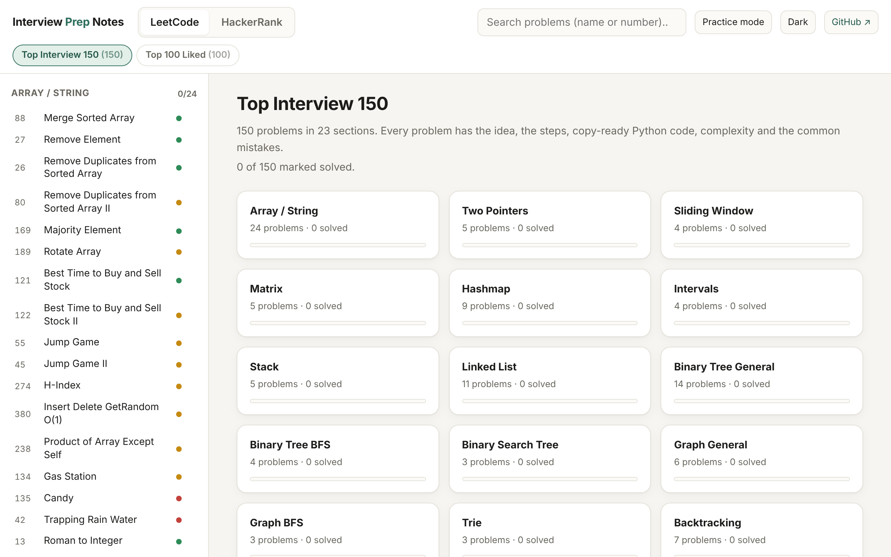
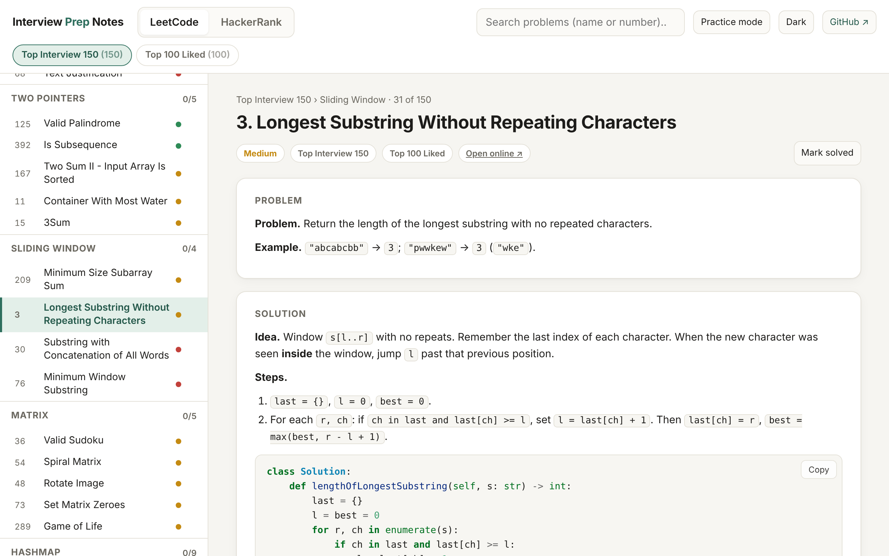
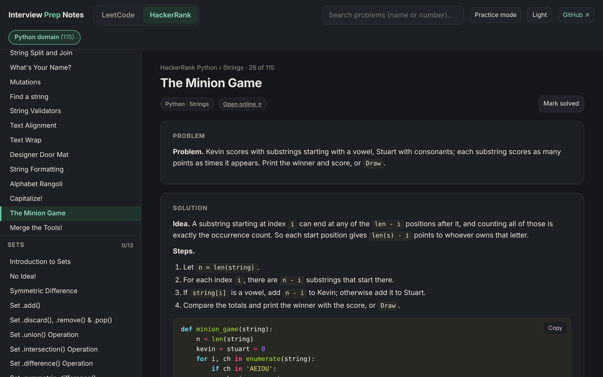

# LeetCode & HackerRank Python Solutions

**Explained Python solutions for LeetCode Top Interview 150, LeetCode Top 100 Liked, and the full HackerRank Python domain.** Every answer covers the idea, numbered steps, copy-ready code, complexity and common mistakes, and every solution is tested.

### 👉 [Open the study site](https://marwantarekzaky.github.io/leetcode-hackerrank-solutions/)

Works in any browser, on phone or desktop. It also works **offline**: download `index.html` and double-click it.



## What's inside

| List | Problems | Sections |
|---|---:|---|
| LeetCode **Top Interview 150** | 150 (40 easy · 92 medium · 18 hard) | 23, in LeetCode's study-plan order: Array / String, Two Pointers, Sliding Window, … Multidimensional DP |
| LeetCode **Top 100 Liked** | 100 (20 easy · 68 medium · 12 hard) | 15: Hashing, Two Pointers, Sliding Window, … Dynamic Programming |
| HackerRank **Python domain** | 115 | 17 subdomains: Introduction, Basic Data Types, Strings, Sets, … Numpy, Debugging |

67 problems appear in both LeetCode lists, so the site has **183 LeetCode problems + 115 HackerRank challenges**.

Every problem page has:

- **Problem**: a short summary in plain words, with an example.
- **Idea**: the key insight, explained before any code.
- **Steps**: what the code does, in numbered steps.
- **Code**: a complete Python solution with a **Copy** button. HackerRank answers are full programs, starter code included.
- **Complexity**: time and space, for LeetCode.
- **Watch out**: the edge cases and mistakes that make people fail hidden tests.
- An **alternative solution** for many problems.

## Features

- **Two tabs**: LeetCode (with *Top Interview 150* / *Top 100 Liked*) and HackerRank, organised by section.
- **Practice mode** hides every solution until you click *Show solution*, so you can try first.
- **Mark solved** puts a ✓ in the sidebar and shows your progress on each section. It's saved in your browser.
- **Search** by problem name or number.
- **Open online ↗** jumps to the original problem on LeetCode or HackerRank.
- **Dark mode** and a phone-friendly layout.
- **One file, no install**: `index.html` contains everything and needs no internet.

| Problem page | Dark mode |
|---|---|
|  |  |

## Tested

Every LeetCode solution runs against the official examples plus extra edge cases. Every HackerRank program runs on the sample input and its output is compared with the expected output.

```bash
pip install -r requirements.txt
python3 build.py --test
```

```
LeetCode test blocks run: 184
HackerRank samples run: 115
ALL TESTS PASSED
```

## Project structure

| Path | What it is |
|---|---|
| `index.html` | The whole site, built from the sources. This is what GitHub Pages serves. |
| `sources/leetcode/*.md` | All LeetCode answers in Markdown, readable right here on GitHub |
| `sources/hackerrank/*.md` | All HackerRank answers in Markdown, grouped by subdomain |
| `lists.py` | The official problem lists, section order and URL slugs |
| `build.py` | Turns the Markdown into `index.html` and runs the tests (`--test`) |
| `template.html` | The page layout, styles and script |
| `docs/` | Screenshots for this README |

### Fixing or improving an answer

1. Edit the problem in `sources/…/*.md`. Each LeetCode problem starts with `### <number>. <title>`; each HackerRank one with `### <name>` under its `## <subdomain>`.
2. Run `python3 build.py --test`. It checks every solution and rebuilds `index.html`.
3. Commit both the `.md` file and `index.html`.

Issues and pull requests are welcome, whether it's a clearer explanation, a better solution or a typo.

## HackerRank notes

- **Tuples**: choose *PyPy 3* as the language. Normal Python 3 computes a different `hash()` than the expected output.
- **Numpy**: HackerRank runs an older NumPy, so the solutions call `numpy.set_printoptions(legacy='1.13')` to match its print format.
- **Incorrect Regex**: on Python 3.11+ `.*+` is a valid (possessive) pattern; on HackerRank it isn't.

## Problem index

Each title opens the explained solution on the study site; the link on the right opens the original problem.

<details>
<summary><b>LeetCode Top Interview 150</b> (150 problems)</summary>

**Array / String** (24)

| # | Problem | Difficulty | Links |
|---:|---|---|---|
| 88 | [Merge Sorted Array](https://marwantarekzaky.github.io/leetcode-hackerrank-solutions/#lc/top150/88) | 🟢 Easy | [LeetCode](https://leetcode.com/problems/merge-sorted-array/) |
| 27 | [Remove Element](https://marwantarekzaky.github.io/leetcode-hackerrank-solutions/#lc/top150/27) | 🟢 Easy | [LeetCode](https://leetcode.com/problems/remove-element/) |
| 26 | [Remove Duplicates from Sorted Array](https://marwantarekzaky.github.io/leetcode-hackerrank-solutions/#lc/top150/26) | 🟢 Easy | [LeetCode](https://leetcode.com/problems/remove-duplicates-from-sorted-array/) |
| 80 | [Remove Duplicates from Sorted Array II](https://marwantarekzaky.github.io/leetcode-hackerrank-solutions/#lc/top150/80) | 🟡 Medium | [LeetCode](https://leetcode.com/problems/remove-duplicates-from-sorted-array-ii/) |
| 169 | [Majority Element](https://marwantarekzaky.github.io/leetcode-hackerrank-solutions/#lc/top150/169) | 🟢 Easy | [LeetCode](https://leetcode.com/problems/majority-element/) |
| 189 | [Rotate Array](https://marwantarekzaky.github.io/leetcode-hackerrank-solutions/#lc/top150/189) | 🟡 Medium | [LeetCode](https://leetcode.com/problems/rotate-array/) |
| 121 | [Best Time to Buy and Sell Stock](https://marwantarekzaky.github.io/leetcode-hackerrank-solutions/#lc/top150/121) | 🟢 Easy | [LeetCode](https://leetcode.com/problems/best-time-to-buy-and-sell-stock/) |
| 122 | [Best Time to Buy and Sell Stock II](https://marwantarekzaky.github.io/leetcode-hackerrank-solutions/#lc/top150/122) | 🟡 Medium | [LeetCode](https://leetcode.com/problems/best-time-to-buy-and-sell-stock-ii/) |
| 55 | [Jump Game](https://marwantarekzaky.github.io/leetcode-hackerrank-solutions/#lc/top150/55) | 🟡 Medium | [LeetCode](https://leetcode.com/problems/jump-game/) |
| 45 | [Jump Game II](https://marwantarekzaky.github.io/leetcode-hackerrank-solutions/#lc/top150/45) | 🟡 Medium | [LeetCode](https://leetcode.com/problems/jump-game-ii/) |
| 274 | [H-Index](https://marwantarekzaky.github.io/leetcode-hackerrank-solutions/#lc/top150/274) | 🟡 Medium | [LeetCode](https://leetcode.com/problems/h-index/) |
| 380 | [Insert Delete GetRandom O(1)](https://marwantarekzaky.github.io/leetcode-hackerrank-solutions/#lc/top150/380) | 🟡 Medium | [LeetCode](https://leetcode.com/problems/insert-delete-getrandom-o1/) |
| 238 | [Product of Array Except Self](https://marwantarekzaky.github.io/leetcode-hackerrank-solutions/#lc/top150/238) | 🟡 Medium | [LeetCode](https://leetcode.com/problems/product-of-array-except-self/) |
| 134 | [Gas Station](https://marwantarekzaky.github.io/leetcode-hackerrank-solutions/#lc/top150/134) | 🟡 Medium | [LeetCode](https://leetcode.com/problems/gas-station/) |
| 135 | [Candy](https://marwantarekzaky.github.io/leetcode-hackerrank-solutions/#lc/top150/135) | 🔴 Hard | [LeetCode](https://leetcode.com/problems/candy/) |
| 42 | [Trapping Rain Water](https://marwantarekzaky.github.io/leetcode-hackerrank-solutions/#lc/top150/42) | 🔴 Hard | [LeetCode](https://leetcode.com/problems/trapping-rain-water/) |
| 13 | [Roman to Integer](https://marwantarekzaky.github.io/leetcode-hackerrank-solutions/#lc/top150/13) | 🟢 Easy | [LeetCode](https://leetcode.com/problems/roman-to-integer/) |
| 12 | [Integer to Roman](https://marwantarekzaky.github.io/leetcode-hackerrank-solutions/#lc/top150/12) | 🟡 Medium | [LeetCode](https://leetcode.com/problems/integer-to-roman/) |
| 58 | [Length of Last Word](https://marwantarekzaky.github.io/leetcode-hackerrank-solutions/#lc/top150/58) | 🟢 Easy | [LeetCode](https://leetcode.com/problems/length-of-last-word/) |
| 14 | [Longest Common Prefix](https://marwantarekzaky.github.io/leetcode-hackerrank-solutions/#lc/top150/14) | 🟢 Easy | [LeetCode](https://leetcode.com/problems/longest-common-prefix/) |
| 151 | [Reverse Words in a String](https://marwantarekzaky.github.io/leetcode-hackerrank-solutions/#lc/top150/151) | 🟡 Medium | [LeetCode](https://leetcode.com/problems/reverse-words-in-a-string/) |
| 6 | [Zigzag Conversion](https://marwantarekzaky.github.io/leetcode-hackerrank-solutions/#lc/top150/6) | 🟡 Medium | [LeetCode](https://leetcode.com/problems/zigzag-conversion/) |
| 28 | [Find the Index of the First Occurrence in a String](https://marwantarekzaky.github.io/leetcode-hackerrank-solutions/#lc/top150/28) | 🟢 Easy | [LeetCode](https://leetcode.com/problems/find-the-index-of-the-first-occurrence-in-a-string/) |
| 68 | [Text Justification](https://marwantarekzaky.github.io/leetcode-hackerrank-solutions/#lc/top150/68) | 🔴 Hard | [LeetCode](https://leetcode.com/problems/text-justification/) |

**Two Pointers** (5)

| # | Problem | Difficulty | Links |
|---:|---|---|---|
| 125 | [Valid Palindrome](https://marwantarekzaky.github.io/leetcode-hackerrank-solutions/#lc/top150/125) | 🟢 Easy | [LeetCode](https://leetcode.com/problems/valid-palindrome/) |
| 392 | [Is Subsequence](https://marwantarekzaky.github.io/leetcode-hackerrank-solutions/#lc/top150/392) | 🟢 Easy | [LeetCode](https://leetcode.com/problems/is-subsequence/) |
| 167 | [Two Sum II - Input Array Is Sorted](https://marwantarekzaky.github.io/leetcode-hackerrank-solutions/#lc/top150/167) | 🟡 Medium | [LeetCode](https://leetcode.com/problems/two-sum-ii-input-array-is-sorted/) |
| 11 | [Container With Most Water](https://marwantarekzaky.github.io/leetcode-hackerrank-solutions/#lc/top150/11) | 🟡 Medium | [LeetCode](https://leetcode.com/problems/container-with-most-water/) |
| 15 | [3Sum](https://marwantarekzaky.github.io/leetcode-hackerrank-solutions/#lc/top150/15) | 🟡 Medium | [LeetCode](https://leetcode.com/problems/3sum/) |

**Sliding Window** (4)

| # | Problem | Difficulty | Links |
|---:|---|---|---|
| 209 | [Minimum Size Subarray Sum](https://marwantarekzaky.github.io/leetcode-hackerrank-solutions/#lc/top150/209) | 🟡 Medium | [LeetCode](https://leetcode.com/problems/minimum-size-subarray-sum/) |
| 3 | [Longest Substring Without Repeating Characters](https://marwantarekzaky.github.io/leetcode-hackerrank-solutions/#lc/top150/3) | 🟡 Medium | [LeetCode](https://leetcode.com/problems/longest-substring-without-repeating-characters/) |
| 30 | [Substring with Concatenation of All Words](https://marwantarekzaky.github.io/leetcode-hackerrank-solutions/#lc/top150/30) | 🔴 Hard | [LeetCode](https://leetcode.com/problems/substring-with-concatenation-of-all-words/) |
| 76 | [Minimum Window Substring](https://marwantarekzaky.github.io/leetcode-hackerrank-solutions/#lc/top150/76) | 🔴 Hard | [LeetCode](https://leetcode.com/problems/minimum-window-substring/) |

**Matrix** (5)

| # | Problem | Difficulty | Links |
|---:|---|---|---|
| 36 | [Valid Sudoku](https://marwantarekzaky.github.io/leetcode-hackerrank-solutions/#lc/top150/36) | 🟡 Medium | [LeetCode](https://leetcode.com/problems/valid-sudoku/) |
| 54 | [Spiral Matrix](https://marwantarekzaky.github.io/leetcode-hackerrank-solutions/#lc/top150/54) | 🟡 Medium | [LeetCode](https://leetcode.com/problems/spiral-matrix/) |
| 48 | [Rotate Image](https://marwantarekzaky.github.io/leetcode-hackerrank-solutions/#lc/top150/48) | 🟡 Medium | [LeetCode](https://leetcode.com/problems/rotate-image/) |
| 73 | [Set Matrix Zeroes](https://marwantarekzaky.github.io/leetcode-hackerrank-solutions/#lc/top150/73) | 🟡 Medium | [LeetCode](https://leetcode.com/problems/set-matrix-zeroes/) |
| 289 | [Game of Life](https://marwantarekzaky.github.io/leetcode-hackerrank-solutions/#lc/top150/289) | 🟡 Medium | [LeetCode](https://leetcode.com/problems/game-of-life/) |

**Hashmap** (9)

| # | Problem | Difficulty | Links |
|---:|---|---|---|
| 383 | [Ransom Note](https://marwantarekzaky.github.io/leetcode-hackerrank-solutions/#lc/top150/383) | 🟢 Easy | [LeetCode](https://leetcode.com/problems/ransom-note/) |
| 205 | [Isomorphic Strings](https://marwantarekzaky.github.io/leetcode-hackerrank-solutions/#lc/top150/205) | 🟢 Easy | [LeetCode](https://leetcode.com/problems/isomorphic-strings/) |
| 290 | [Word Pattern](https://marwantarekzaky.github.io/leetcode-hackerrank-solutions/#lc/top150/290) | 🟢 Easy | [LeetCode](https://leetcode.com/problems/word-pattern/) |
| 242 | [Valid Anagram](https://marwantarekzaky.github.io/leetcode-hackerrank-solutions/#lc/top150/242) | 🟢 Easy | [LeetCode](https://leetcode.com/problems/valid-anagram/) |
| 49 | [Group Anagrams](https://marwantarekzaky.github.io/leetcode-hackerrank-solutions/#lc/top150/49) | 🟡 Medium | [LeetCode](https://leetcode.com/problems/group-anagrams/) |
| 1 | [Two Sum](https://marwantarekzaky.github.io/leetcode-hackerrank-solutions/#lc/top150/1) | 🟢 Easy | [LeetCode](https://leetcode.com/problems/two-sum/) |
| 202 | [Happy Number](https://marwantarekzaky.github.io/leetcode-hackerrank-solutions/#lc/top150/202) | 🟢 Easy | [LeetCode](https://leetcode.com/problems/happy-number/) |
| 219 | [Contains Duplicate II](https://marwantarekzaky.github.io/leetcode-hackerrank-solutions/#lc/top150/219) | 🟢 Easy | [LeetCode](https://leetcode.com/problems/contains-duplicate-ii/) |
| 128 | [Longest Consecutive Sequence](https://marwantarekzaky.github.io/leetcode-hackerrank-solutions/#lc/top150/128) | 🟡 Medium | [LeetCode](https://leetcode.com/problems/longest-consecutive-sequence/) |

**Intervals** (4)

| # | Problem | Difficulty | Links |
|---:|---|---|---|
| 228 | [Summary Ranges](https://marwantarekzaky.github.io/leetcode-hackerrank-solutions/#lc/top150/228) | 🟢 Easy | [LeetCode](https://leetcode.com/problems/summary-ranges/) |
| 56 | [Merge Intervals](https://marwantarekzaky.github.io/leetcode-hackerrank-solutions/#lc/top150/56) | 🟡 Medium | [LeetCode](https://leetcode.com/problems/merge-intervals/) |
| 57 | [Insert Interval](https://marwantarekzaky.github.io/leetcode-hackerrank-solutions/#lc/top150/57) | 🟡 Medium | [LeetCode](https://leetcode.com/problems/insert-interval/) |
| 452 | [Minimum Number of Arrows to Burst Balloons](https://marwantarekzaky.github.io/leetcode-hackerrank-solutions/#lc/top150/452) | 🟡 Medium | [LeetCode](https://leetcode.com/problems/minimum-number-of-arrows-to-burst-balloons/) |

**Stack** (5)

| # | Problem | Difficulty | Links |
|---:|---|---|---|
| 20 | [Valid Parentheses](https://marwantarekzaky.github.io/leetcode-hackerrank-solutions/#lc/top150/20) | 🟢 Easy | [LeetCode](https://leetcode.com/problems/valid-parentheses/) |
| 71 | [Simplify Path](https://marwantarekzaky.github.io/leetcode-hackerrank-solutions/#lc/top150/71) | 🟡 Medium | [LeetCode](https://leetcode.com/problems/simplify-path/) |
| 155 | [Min Stack](https://marwantarekzaky.github.io/leetcode-hackerrank-solutions/#lc/top150/155) | 🟡 Medium | [LeetCode](https://leetcode.com/problems/min-stack/) |
| 150 | [Evaluate Reverse Polish Notation](https://marwantarekzaky.github.io/leetcode-hackerrank-solutions/#lc/top150/150) | 🟡 Medium | [LeetCode](https://leetcode.com/problems/evaluate-reverse-polish-notation/) |
| 224 | [Basic Calculator](https://marwantarekzaky.github.io/leetcode-hackerrank-solutions/#lc/top150/224) | 🔴 Hard | [LeetCode](https://leetcode.com/problems/basic-calculator/) |

**Linked List** (11)

| # | Problem | Difficulty | Links |
|---:|---|---|---|
| 141 | [Linked List Cycle](https://marwantarekzaky.github.io/leetcode-hackerrank-solutions/#lc/top150/141) | 🟢 Easy | [LeetCode](https://leetcode.com/problems/linked-list-cycle/) |
| 2 | [Add Two Numbers](https://marwantarekzaky.github.io/leetcode-hackerrank-solutions/#lc/top150/2) | 🟡 Medium | [LeetCode](https://leetcode.com/problems/add-two-numbers/) |
| 21 | [Merge Two Sorted Lists](https://marwantarekzaky.github.io/leetcode-hackerrank-solutions/#lc/top150/21) | 🟢 Easy | [LeetCode](https://leetcode.com/problems/merge-two-sorted-lists/) |
| 138 | [Copy List with Random Pointer](https://marwantarekzaky.github.io/leetcode-hackerrank-solutions/#lc/top150/138) | 🟡 Medium | [LeetCode](https://leetcode.com/problems/copy-list-with-random-pointer/) |
| 92 | [Reverse Linked List II](https://marwantarekzaky.github.io/leetcode-hackerrank-solutions/#lc/top150/92) | 🟡 Medium | [LeetCode](https://leetcode.com/problems/reverse-linked-list-ii/) |
| 25 | [Reverse Nodes in k-Group](https://marwantarekzaky.github.io/leetcode-hackerrank-solutions/#lc/top150/25) | 🔴 Hard | [LeetCode](https://leetcode.com/problems/reverse-nodes-in-k-group/) |
| 19 | [Remove Nth Node From End of List](https://marwantarekzaky.github.io/leetcode-hackerrank-solutions/#lc/top150/19) | 🟡 Medium | [LeetCode](https://leetcode.com/problems/remove-nth-node-from-end-of-list/) |
| 82 | [Remove Duplicates from Sorted List II](https://marwantarekzaky.github.io/leetcode-hackerrank-solutions/#lc/top150/82) | 🟡 Medium | [LeetCode](https://leetcode.com/problems/remove-duplicates-from-sorted-list-ii/) |
| 61 | [Rotate List](https://marwantarekzaky.github.io/leetcode-hackerrank-solutions/#lc/top150/61) | 🟡 Medium | [LeetCode](https://leetcode.com/problems/rotate-list/) |
| 86 | [Partition List](https://marwantarekzaky.github.io/leetcode-hackerrank-solutions/#lc/top150/86) | 🟡 Medium | [LeetCode](https://leetcode.com/problems/partition-list/) |
| 146 | [LRU Cache](https://marwantarekzaky.github.io/leetcode-hackerrank-solutions/#lc/top150/146) | 🟡 Medium | [LeetCode](https://leetcode.com/problems/lru-cache/) |

**Binary Tree General** (14)

| # | Problem | Difficulty | Links |
|---:|---|---|---|
| 104 | [Maximum Depth of Binary Tree](https://marwantarekzaky.github.io/leetcode-hackerrank-solutions/#lc/top150/104) | 🟢 Easy | [LeetCode](https://leetcode.com/problems/maximum-depth-of-binary-tree/) |
| 100 | [Same Tree](https://marwantarekzaky.github.io/leetcode-hackerrank-solutions/#lc/top150/100) | 🟢 Easy | [LeetCode](https://leetcode.com/problems/same-tree/) |
| 226 | [Invert Binary Tree](https://marwantarekzaky.github.io/leetcode-hackerrank-solutions/#lc/top150/226) | 🟢 Easy | [LeetCode](https://leetcode.com/problems/invert-binary-tree/) |
| 101 | [Symmetric Tree](https://marwantarekzaky.github.io/leetcode-hackerrank-solutions/#lc/top150/101) | 🟢 Easy | [LeetCode](https://leetcode.com/problems/symmetric-tree/) |
| 105 | [Construct Binary Tree from Preorder and Inorder Traversal](https://marwantarekzaky.github.io/leetcode-hackerrank-solutions/#lc/top150/105) | 🟡 Medium | [LeetCode](https://leetcode.com/problems/construct-binary-tree-from-preorder-and-inorder-traversal/) |
| 106 | [Construct Binary Tree from Inorder and Postorder Traversal](https://marwantarekzaky.github.io/leetcode-hackerrank-solutions/#lc/top150/106) | 🟡 Medium | [LeetCode](https://leetcode.com/problems/construct-binary-tree-from-inorder-and-postorder-traversal/) |
| 117 | [Populating Next Right Pointers in Each Node II](https://marwantarekzaky.github.io/leetcode-hackerrank-solutions/#lc/top150/117) | 🟡 Medium | [LeetCode](https://leetcode.com/problems/populating-next-right-pointers-in-each-node-ii/) |
| 114 | [Flatten Binary Tree to Linked List](https://marwantarekzaky.github.io/leetcode-hackerrank-solutions/#lc/top150/114) | 🟡 Medium | [LeetCode](https://leetcode.com/problems/flatten-binary-tree-to-linked-list/) |
| 112 | [Path Sum](https://marwantarekzaky.github.io/leetcode-hackerrank-solutions/#lc/top150/112) | 🟢 Easy | [LeetCode](https://leetcode.com/problems/path-sum/) |
| 129 | [Sum Root to Leaf Numbers](https://marwantarekzaky.github.io/leetcode-hackerrank-solutions/#lc/top150/129) | 🟡 Medium | [LeetCode](https://leetcode.com/problems/sum-root-to-leaf-numbers/) |
| 124 | [Binary Tree Maximum Path Sum](https://marwantarekzaky.github.io/leetcode-hackerrank-solutions/#lc/top150/124) | 🔴 Hard | [LeetCode](https://leetcode.com/problems/binary-tree-maximum-path-sum/) |
| 173 | [Binary Search Tree Iterator](https://marwantarekzaky.github.io/leetcode-hackerrank-solutions/#lc/top150/173) | 🟡 Medium | [LeetCode](https://leetcode.com/problems/binary-search-tree-iterator/) |
| 222 | [Count Complete Tree Nodes](https://marwantarekzaky.github.io/leetcode-hackerrank-solutions/#lc/top150/222) | 🟢 Easy | [LeetCode](https://leetcode.com/problems/count-complete-tree-nodes/) |
| 236 | [Lowest Common Ancestor of a Binary Tree](https://marwantarekzaky.github.io/leetcode-hackerrank-solutions/#lc/top150/236) | 🟡 Medium | [LeetCode](https://leetcode.com/problems/lowest-common-ancestor-of-a-binary-tree/) |

**Binary Tree BFS** (4)

| # | Problem | Difficulty | Links |
|---:|---|---|---|
| 199 | [Binary Tree Right Side View](https://marwantarekzaky.github.io/leetcode-hackerrank-solutions/#lc/top150/199) | 🟡 Medium | [LeetCode](https://leetcode.com/problems/binary-tree-right-side-view/) |
| 637 | [Average of Levels in Binary Tree](https://marwantarekzaky.github.io/leetcode-hackerrank-solutions/#lc/top150/637) | 🟢 Easy | [LeetCode](https://leetcode.com/problems/average-of-levels-in-binary-tree/) |
| 102 | [Binary Tree Level Order Traversal](https://marwantarekzaky.github.io/leetcode-hackerrank-solutions/#lc/top150/102) | 🟡 Medium | [LeetCode](https://leetcode.com/problems/binary-tree-level-order-traversal/) |
| 103 | [Binary Tree Zigzag Level Order Traversal](https://marwantarekzaky.github.io/leetcode-hackerrank-solutions/#lc/top150/103) | 🟡 Medium | [LeetCode](https://leetcode.com/problems/binary-tree-zigzag-level-order-traversal/) |

**Binary Search Tree** (3)

| # | Problem | Difficulty | Links |
|---:|---|---|---|
| 530 | [Minimum Absolute Difference in BST](https://marwantarekzaky.github.io/leetcode-hackerrank-solutions/#lc/top150/530) | 🟢 Easy | [LeetCode](https://leetcode.com/problems/minimum-absolute-difference-in-bst/) |
| 230 | [Kth Smallest Element in a BST](https://marwantarekzaky.github.io/leetcode-hackerrank-solutions/#lc/top150/230) | 🟡 Medium | [LeetCode](https://leetcode.com/problems/kth-smallest-element-in-a-bst/) |
| 98 | [Validate Binary Search Tree](https://marwantarekzaky.github.io/leetcode-hackerrank-solutions/#lc/top150/98) | 🟡 Medium | [LeetCode](https://leetcode.com/problems/validate-binary-search-tree/) |

**Graph General** (6)

| # | Problem | Difficulty | Links |
|---:|---|---|---|
| 200 | [Number of Islands](https://marwantarekzaky.github.io/leetcode-hackerrank-solutions/#lc/top150/200) | 🟡 Medium | [LeetCode](https://leetcode.com/problems/number-of-islands/) |
| 130 | [Surrounded Regions](https://marwantarekzaky.github.io/leetcode-hackerrank-solutions/#lc/top150/130) | 🟡 Medium | [LeetCode](https://leetcode.com/problems/surrounded-regions/) |
| 133 | [Clone Graph](https://marwantarekzaky.github.io/leetcode-hackerrank-solutions/#lc/top150/133) | 🟡 Medium | [LeetCode](https://leetcode.com/problems/clone-graph/) |
| 399 | [Evaluate Division](https://marwantarekzaky.github.io/leetcode-hackerrank-solutions/#lc/top150/399) | 🟡 Medium | [LeetCode](https://leetcode.com/problems/evaluate-division/) |
| 207 | [Course Schedule](https://marwantarekzaky.github.io/leetcode-hackerrank-solutions/#lc/top150/207) | 🟡 Medium | [LeetCode](https://leetcode.com/problems/course-schedule/) |
| 210 | [Course Schedule II](https://marwantarekzaky.github.io/leetcode-hackerrank-solutions/#lc/top150/210) | 🟡 Medium | [LeetCode](https://leetcode.com/problems/course-schedule-ii/) |

**Graph BFS** (3)

| # | Problem | Difficulty | Links |
|---:|---|---|---|
| 909 | [Snakes and Ladders](https://marwantarekzaky.github.io/leetcode-hackerrank-solutions/#lc/top150/909) | 🟡 Medium | [LeetCode](https://leetcode.com/problems/snakes-and-ladders/) |
| 433 | [Minimum Genetic Mutation](https://marwantarekzaky.github.io/leetcode-hackerrank-solutions/#lc/top150/433) | 🟡 Medium | [LeetCode](https://leetcode.com/problems/minimum-genetic-mutation/) |
| 127 | [Word Ladder](https://marwantarekzaky.github.io/leetcode-hackerrank-solutions/#lc/top150/127) | 🔴 Hard | [LeetCode](https://leetcode.com/problems/word-ladder/) |

**Trie** (3)

| # | Problem | Difficulty | Links |
|---:|---|---|---|
| 208 | [Implement Trie (Prefix Tree)](https://marwantarekzaky.github.io/leetcode-hackerrank-solutions/#lc/top150/208) | 🟡 Medium | [LeetCode](https://leetcode.com/problems/implement-trie-prefix-tree/) |
| 211 | [Design Add and Search Words Data Structure](https://marwantarekzaky.github.io/leetcode-hackerrank-solutions/#lc/top150/211) | 🟡 Medium | [LeetCode](https://leetcode.com/problems/design-add-and-search-words-data-structure/) |
| 212 | [Word Search II](https://marwantarekzaky.github.io/leetcode-hackerrank-solutions/#lc/top150/212) | 🔴 Hard | [LeetCode](https://leetcode.com/problems/word-search-ii/) |

**Backtracking** (7)

| # | Problem | Difficulty | Links |
|---:|---|---|---|
| 17 | [Letter Combinations of a Phone Number](https://marwantarekzaky.github.io/leetcode-hackerrank-solutions/#lc/top150/17) | 🟡 Medium | [LeetCode](https://leetcode.com/problems/letter-combinations-of-a-phone-number/) |
| 77 | [Combinations](https://marwantarekzaky.github.io/leetcode-hackerrank-solutions/#lc/top150/77) | 🟡 Medium | [LeetCode](https://leetcode.com/problems/combinations/) |
| 46 | [Permutations](https://marwantarekzaky.github.io/leetcode-hackerrank-solutions/#lc/top150/46) | 🟡 Medium | [LeetCode](https://leetcode.com/problems/permutations/) |
| 39 | [Combination Sum](https://marwantarekzaky.github.io/leetcode-hackerrank-solutions/#lc/top150/39) | 🟡 Medium | [LeetCode](https://leetcode.com/problems/combination-sum/) |
| 52 | [N-Queens II](https://marwantarekzaky.github.io/leetcode-hackerrank-solutions/#lc/top150/52) | 🔴 Hard | [LeetCode](https://leetcode.com/problems/n-queens-ii/) |
| 22 | [Generate Parentheses](https://marwantarekzaky.github.io/leetcode-hackerrank-solutions/#lc/top150/22) | 🟡 Medium | [LeetCode](https://leetcode.com/problems/generate-parentheses/) |
| 79 | [Word Search](https://marwantarekzaky.github.io/leetcode-hackerrank-solutions/#lc/top150/79) | 🟡 Medium | [LeetCode](https://leetcode.com/problems/word-search/) |

**Divide & Conquer** (4)

| # | Problem | Difficulty | Links |
|---:|---|---|---|
| 108 | [Convert Sorted Array to Binary Search Tree](https://marwantarekzaky.github.io/leetcode-hackerrank-solutions/#lc/top150/108) | 🟢 Easy | [LeetCode](https://leetcode.com/problems/convert-sorted-array-to-binary-search-tree/) |
| 148 | [Sort List](https://marwantarekzaky.github.io/leetcode-hackerrank-solutions/#lc/top150/148) | 🟡 Medium | [LeetCode](https://leetcode.com/problems/sort-list/) |
| 427 | [Construct Quad Tree](https://marwantarekzaky.github.io/leetcode-hackerrank-solutions/#lc/top150/427) | 🟡 Medium | [LeetCode](https://leetcode.com/problems/construct-quad-tree/) |
| 23 | [Merge k Sorted Lists](https://marwantarekzaky.github.io/leetcode-hackerrank-solutions/#lc/top150/23) | 🔴 Hard | [LeetCode](https://leetcode.com/problems/merge-k-sorted-lists/) |

**Kadane's Algorithm** (2)

| # | Problem | Difficulty | Links |
|---:|---|---|---|
| 53 | [Maximum Subarray](https://marwantarekzaky.github.io/leetcode-hackerrank-solutions/#lc/top150/53) | 🟡 Medium | [LeetCode](https://leetcode.com/problems/maximum-subarray/) |
| 918 | [Maximum Sum Circular Subarray](https://marwantarekzaky.github.io/leetcode-hackerrank-solutions/#lc/top150/918) | 🟡 Medium | [LeetCode](https://leetcode.com/problems/maximum-sum-circular-subarray/) |

**Binary Search** (7)

| # | Problem | Difficulty | Links |
|---:|---|---|---|
| 35 | [Search Insert Position](https://marwantarekzaky.github.io/leetcode-hackerrank-solutions/#lc/top150/35) | 🟢 Easy | [LeetCode](https://leetcode.com/problems/search-insert-position/) |
| 74 | [Search a 2D Matrix](https://marwantarekzaky.github.io/leetcode-hackerrank-solutions/#lc/top150/74) | 🟡 Medium | [LeetCode](https://leetcode.com/problems/search-a-2d-matrix/) |
| 162 | [Find Peak Element](https://marwantarekzaky.github.io/leetcode-hackerrank-solutions/#lc/top150/162) | 🟡 Medium | [LeetCode](https://leetcode.com/problems/find-peak-element/) |
| 33 | [Search in Rotated Sorted Array](https://marwantarekzaky.github.io/leetcode-hackerrank-solutions/#lc/top150/33) | 🟡 Medium | [LeetCode](https://leetcode.com/problems/search-in-rotated-sorted-array/) |
| 34 | [Find First and Last Position of Element in Sorted Array](https://marwantarekzaky.github.io/leetcode-hackerrank-solutions/#lc/top150/34) | 🟡 Medium | [LeetCode](https://leetcode.com/problems/find-first-and-last-position-of-element-in-sorted-array/) |
| 153 | [Find Minimum in Rotated Sorted Array](https://marwantarekzaky.github.io/leetcode-hackerrank-solutions/#lc/top150/153) | 🟡 Medium | [LeetCode](https://leetcode.com/problems/find-minimum-in-rotated-sorted-array/) |
| 4 | [Median of Two Sorted Arrays](https://marwantarekzaky.github.io/leetcode-hackerrank-solutions/#lc/top150/4) | 🔴 Hard | [LeetCode](https://leetcode.com/problems/median-of-two-sorted-arrays/) |

**Heap** (4)

| # | Problem | Difficulty | Links |
|---:|---|---|---|
| 215 | [Kth Largest Element in an Array](https://marwantarekzaky.github.io/leetcode-hackerrank-solutions/#lc/top150/215) | 🟡 Medium | [LeetCode](https://leetcode.com/problems/kth-largest-element-in-an-array/) |
| 502 | [IPO](https://marwantarekzaky.github.io/leetcode-hackerrank-solutions/#lc/top150/502) | 🔴 Hard | [LeetCode](https://leetcode.com/problems/ipo/) |
| 373 | [Find K Pairs with Smallest Sums](https://marwantarekzaky.github.io/leetcode-hackerrank-solutions/#lc/top150/373) | 🟡 Medium | [LeetCode](https://leetcode.com/problems/find-k-pairs-with-smallest-sums/) |
| 295 | [Find Median from Data Stream](https://marwantarekzaky.github.io/leetcode-hackerrank-solutions/#lc/top150/295) | 🔴 Hard | [LeetCode](https://leetcode.com/problems/find-median-from-data-stream/) |

**Bit Manipulation** (6)

| # | Problem | Difficulty | Links |
|---:|---|---|---|
| 67 | [Add Binary](https://marwantarekzaky.github.io/leetcode-hackerrank-solutions/#lc/top150/67) | 🟢 Easy | [LeetCode](https://leetcode.com/problems/add-binary/) |
| 190 | [Reverse Bits](https://marwantarekzaky.github.io/leetcode-hackerrank-solutions/#lc/top150/190) | 🟢 Easy | [LeetCode](https://leetcode.com/problems/reverse-bits/) |
| 191 | [Number of 1 Bits](https://marwantarekzaky.github.io/leetcode-hackerrank-solutions/#lc/top150/191) | 🟢 Easy | [LeetCode](https://leetcode.com/problems/number-of-1-bits/) |
| 136 | [Single Number](https://marwantarekzaky.github.io/leetcode-hackerrank-solutions/#lc/top150/136) | 🟢 Easy | [LeetCode](https://leetcode.com/problems/single-number/) |
| 137 | [Single Number II](https://marwantarekzaky.github.io/leetcode-hackerrank-solutions/#lc/top150/137) | 🟡 Medium | [LeetCode](https://leetcode.com/problems/single-number-ii/) |
| 201 | [Bitwise AND of Numbers Range](https://marwantarekzaky.github.io/leetcode-hackerrank-solutions/#lc/top150/201) | 🟡 Medium | [LeetCode](https://leetcode.com/problems/bitwise-and-of-numbers-range/) |

**Math** (6)

| # | Problem | Difficulty | Links |
|---:|---|---|---|
| 9 | [Palindrome Number](https://marwantarekzaky.github.io/leetcode-hackerrank-solutions/#lc/top150/9) | 🟢 Easy | [LeetCode](https://leetcode.com/problems/palindrome-number/) |
| 66 | [Plus One](https://marwantarekzaky.github.io/leetcode-hackerrank-solutions/#lc/top150/66) | 🟢 Easy | [LeetCode](https://leetcode.com/problems/plus-one/) |
| 172 | [Factorial Trailing Zeroes](https://marwantarekzaky.github.io/leetcode-hackerrank-solutions/#lc/top150/172) | 🟡 Medium | [LeetCode](https://leetcode.com/problems/factorial-trailing-zeroes/) |
| 69 | [Sqrt(x)](https://marwantarekzaky.github.io/leetcode-hackerrank-solutions/#lc/top150/69) | 🟢 Easy | [LeetCode](https://leetcode.com/problems/sqrtx/) |
| 50 | [Pow(x, n)](https://marwantarekzaky.github.io/leetcode-hackerrank-solutions/#lc/top150/50) | 🟡 Medium | [LeetCode](https://leetcode.com/problems/powx-n/) |
| 149 | [Max Points on a Line](https://marwantarekzaky.github.io/leetcode-hackerrank-solutions/#lc/top150/149) | 🔴 Hard | [LeetCode](https://leetcode.com/problems/max-points-on-a-line/) |

**1D DP** (5)

| # | Problem | Difficulty | Links |
|---:|---|---|---|
| 70 | [Climbing Stairs](https://marwantarekzaky.github.io/leetcode-hackerrank-solutions/#lc/top150/70) | 🟢 Easy | [LeetCode](https://leetcode.com/problems/climbing-stairs/) |
| 198 | [House Robber](https://marwantarekzaky.github.io/leetcode-hackerrank-solutions/#lc/top150/198) | 🟡 Medium | [LeetCode](https://leetcode.com/problems/house-robber/) |
| 139 | [Word Break](https://marwantarekzaky.github.io/leetcode-hackerrank-solutions/#lc/top150/139) | 🟡 Medium | [LeetCode](https://leetcode.com/problems/word-break/) |
| 322 | [Coin Change](https://marwantarekzaky.github.io/leetcode-hackerrank-solutions/#lc/top150/322) | 🟡 Medium | [LeetCode](https://leetcode.com/problems/coin-change/) |
| 300 | [Longest Increasing Subsequence](https://marwantarekzaky.github.io/leetcode-hackerrank-solutions/#lc/top150/300) | 🟡 Medium | [LeetCode](https://leetcode.com/problems/longest-increasing-subsequence/) |

**Multidimensional DP** (9)

| # | Problem | Difficulty | Links |
|---:|---|---|---|
| 120 | [Triangle](https://marwantarekzaky.github.io/leetcode-hackerrank-solutions/#lc/top150/120) | 🟡 Medium | [LeetCode](https://leetcode.com/problems/triangle/) |
| 64 | [Minimum Path Sum](https://marwantarekzaky.github.io/leetcode-hackerrank-solutions/#lc/top150/64) | 🟡 Medium | [LeetCode](https://leetcode.com/problems/minimum-path-sum/) |
| 63 | [Unique Paths II](https://marwantarekzaky.github.io/leetcode-hackerrank-solutions/#lc/top150/63) | 🟡 Medium | [LeetCode](https://leetcode.com/problems/unique-paths-ii/) |
| 5 | [Longest Palindromic Substring](https://marwantarekzaky.github.io/leetcode-hackerrank-solutions/#lc/top150/5) | 🟡 Medium | [LeetCode](https://leetcode.com/problems/longest-palindromic-substring/) |
| 97 | [Interleaving String](https://marwantarekzaky.github.io/leetcode-hackerrank-solutions/#lc/top150/97) | 🟡 Medium | [LeetCode](https://leetcode.com/problems/interleaving-string/) |
| 72 | [Edit Distance](https://marwantarekzaky.github.io/leetcode-hackerrank-solutions/#lc/top150/72) | 🟡 Medium | [LeetCode](https://leetcode.com/problems/edit-distance/) |
| 123 | [Best Time to Buy and Sell Stock III](https://marwantarekzaky.github.io/leetcode-hackerrank-solutions/#lc/top150/123) | 🔴 Hard | [LeetCode](https://leetcode.com/problems/best-time-to-buy-and-sell-stock-iii/) |
| 188 | [Best Time to Buy and Sell Stock IV](https://marwantarekzaky.github.io/leetcode-hackerrank-solutions/#lc/top150/188) | 🔴 Hard | [LeetCode](https://leetcode.com/problems/best-time-to-buy-and-sell-stock-iv/) |
| 221 | [Maximal Square](https://marwantarekzaky.github.io/leetcode-hackerrank-solutions/#lc/top150/221) | 🟡 Medium | [LeetCode](https://leetcode.com/problems/maximal-square/) |

</details>

<details>
<summary><b>LeetCode Top 100 Liked</b> (100 problems)</summary>

**Hashing** (4)

| # | Problem | Difficulty | Links |
|---:|---|---|---|
| 1 | [Two Sum](https://marwantarekzaky.github.io/leetcode-hackerrank-solutions/#lc/top100/1) | 🟢 Easy | [LeetCode](https://leetcode.com/problems/two-sum/) |
| 49 | [Group Anagrams](https://marwantarekzaky.github.io/leetcode-hackerrank-solutions/#lc/top100/49) | 🟡 Medium | [LeetCode](https://leetcode.com/problems/group-anagrams/) |
| 128 | [Longest Consecutive Sequence](https://marwantarekzaky.github.io/leetcode-hackerrank-solutions/#lc/top100/128) | 🟡 Medium | [LeetCode](https://leetcode.com/problems/longest-consecutive-sequence/) |
| 560 | [Subarray Sum Equals K](https://marwantarekzaky.github.io/leetcode-hackerrank-solutions/#lc/top100/560) | 🟡 Medium | [LeetCode](https://leetcode.com/problems/subarray-sum-equals-k/) |

**Two Pointers** (4)

| # | Problem | Difficulty | Links |
|---:|---|---|---|
| 11 | [Container With Most Water](https://marwantarekzaky.github.io/leetcode-hackerrank-solutions/#lc/top100/11) | 🟡 Medium | [LeetCode](https://leetcode.com/problems/container-with-most-water/) |
| 15 | [3Sum](https://marwantarekzaky.github.io/leetcode-hackerrank-solutions/#lc/top100/15) | 🟡 Medium | [LeetCode](https://leetcode.com/problems/3sum/) |
| 42 | [Trapping Rain Water](https://marwantarekzaky.github.io/leetcode-hackerrank-solutions/#lc/top100/42) | 🔴 Hard | [LeetCode](https://leetcode.com/problems/trapping-rain-water/) |
| 283 | [Move Zeroes](https://marwantarekzaky.github.io/leetcode-hackerrank-solutions/#lc/top100/283) | 🟢 Easy | [LeetCode](https://leetcode.com/problems/move-zeroes/) |

**Sliding Window** (4)

| # | Problem | Difficulty | Links |
|---:|---|---|---|
| 3 | [Longest Substring Without Repeating Characters](https://marwantarekzaky.github.io/leetcode-hackerrank-solutions/#lc/top100/3) | 🟡 Medium | [LeetCode](https://leetcode.com/problems/longest-substring-without-repeating-characters/) |
| 76 | [Minimum Window Substring](https://marwantarekzaky.github.io/leetcode-hackerrank-solutions/#lc/top100/76) | 🔴 Hard | [LeetCode](https://leetcode.com/problems/minimum-window-substring/) |
| 239 | [Sliding Window Maximum](https://marwantarekzaky.github.io/leetcode-hackerrank-solutions/#lc/top100/239) | 🔴 Hard | [LeetCode](https://leetcode.com/problems/sliding-window-maximum/) |
| 438 | [Find All Anagrams in a String](https://marwantarekzaky.github.io/leetcode-hackerrank-solutions/#lc/top100/438) | 🟡 Medium | [LeetCode](https://leetcode.com/problems/find-all-anagrams-in-a-string/) |

**Matrix** (4)

| # | Problem | Difficulty | Links |
|---:|---|---|---|
| 48 | [Rotate Image](https://marwantarekzaky.github.io/leetcode-hackerrank-solutions/#lc/top100/48) | 🟡 Medium | [LeetCode](https://leetcode.com/problems/rotate-image/) |
| 54 | [Spiral Matrix](https://marwantarekzaky.github.io/leetcode-hackerrank-solutions/#lc/top100/54) | 🟡 Medium | [LeetCode](https://leetcode.com/problems/spiral-matrix/) |
| 73 | [Set Matrix Zeroes](https://marwantarekzaky.github.io/leetcode-hackerrank-solutions/#lc/top100/73) | 🟡 Medium | [LeetCode](https://leetcode.com/problems/set-matrix-zeroes/) |
| 240 | [Search a 2D Matrix II](https://marwantarekzaky.github.io/leetcode-hackerrank-solutions/#lc/top100/240) | 🟡 Medium | [LeetCode](https://leetcode.com/problems/search-a-2d-matrix-ii/) |

**Linked Lists** (14)

| # | Problem | Difficulty | Links |
|---:|---|---|---|
| 2 | [Add Two Numbers](https://marwantarekzaky.github.io/leetcode-hackerrank-solutions/#lc/top100/2) | 🟡 Medium | [LeetCode](https://leetcode.com/problems/add-two-numbers/) |
| 19 | [Remove Nth Node From End of List](https://marwantarekzaky.github.io/leetcode-hackerrank-solutions/#lc/top100/19) | 🟡 Medium | [LeetCode](https://leetcode.com/problems/remove-nth-node-from-end-of-list/) |
| 21 | [Merge Two Sorted Lists](https://marwantarekzaky.github.io/leetcode-hackerrank-solutions/#lc/top100/21) | 🟢 Easy | [LeetCode](https://leetcode.com/problems/merge-two-sorted-lists/) |
| 23 | [Merge k Sorted Lists](https://marwantarekzaky.github.io/leetcode-hackerrank-solutions/#lc/top100/23) | 🔴 Hard | [LeetCode](https://leetcode.com/problems/merge-k-sorted-lists/) |
| 24 | [Swap Nodes in Pairs](https://marwantarekzaky.github.io/leetcode-hackerrank-solutions/#lc/top100/24) | 🟡 Medium | [LeetCode](https://leetcode.com/problems/swap-nodes-in-pairs/) |
| 25 | [Reverse Nodes in k-Group](https://marwantarekzaky.github.io/leetcode-hackerrank-solutions/#lc/top100/25) | 🔴 Hard | [LeetCode](https://leetcode.com/problems/reverse-nodes-in-k-group/) |
| 138 | [Copy List with Random Pointer](https://marwantarekzaky.github.io/leetcode-hackerrank-solutions/#lc/top100/138) | 🟡 Medium | [LeetCode](https://leetcode.com/problems/copy-list-with-random-pointer/) |
| 141 | [Linked List Cycle](https://marwantarekzaky.github.io/leetcode-hackerrank-solutions/#lc/top100/141) | 🟢 Easy | [LeetCode](https://leetcode.com/problems/linked-list-cycle/) |
| 142 | [Linked List Cycle II](https://marwantarekzaky.github.io/leetcode-hackerrank-solutions/#lc/top100/142) | 🟡 Medium | [LeetCode](https://leetcode.com/problems/linked-list-cycle-ii/) |
| 146 | [LRU Cache](https://marwantarekzaky.github.io/leetcode-hackerrank-solutions/#lc/top100/146) | 🟡 Medium | [LeetCode](https://leetcode.com/problems/lru-cache/) |
| 148 | [Sort List](https://marwantarekzaky.github.io/leetcode-hackerrank-solutions/#lc/top100/148) | 🟡 Medium | [LeetCode](https://leetcode.com/problems/sort-list/) |
| 160 | [Intersection of Two Linked Lists](https://marwantarekzaky.github.io/leetcode-hackerrank-solutions/#lc/top100/160) | 🟢 Easy | [LeetCode](https://leetcode.com/problems/intersection-of-two-linked-lists/) |
| 206 | [Reverse Linked List](https://marwantarekzaky.github.io/leetcode-hackerrank-solutions/#lc/top100/206) | 🟢 Easy | [LeetCode](https://leetcode.com/problems/reverse-linked-list/) |
| 234 | [Palindrome Linked List](https://marwantarekzaky.github.io/leetcode-hackerrank-solutions/#lc/top100/234) | 🟢 Easy | [LeetCode](https://leetcode.com/problems/palindrome-linked-list/) |

**Binary Tree** (14)

| # | Problem | Difficulty | Links |
|---:|---|---|---|
| 94 | [Binary Tree Inorder Traversal](https://marwantarekzaky.github.io/leetcode-hackerrank-solutions/#lc/top100/94) | 🟢 Easy | [LeetCode](https://leetcode.com/problems/binary-tree-inorder-traversal/) |
| 98 | [Validate Binary Search Tree](https://marwantarekzaky.github.io/leetcode-hackerrank-solutions/#lc/top100/98) | 🟡 Medium | [LeetCode](https://leetcode.com/problems/validate-binary-search-tree/) |
| 101 | [Symmetric Tree](https://marwantarekzaky.github.io/leetcode-hackerrank-solutions/#lc/top100/101) | 🟢 Easy | [LeetCode](https://leetcode.com/problems/symmetric-tree/) |
| 102 | [Binary Tree Level Order Traversal](https://marwantarekzaky.github.io/leetcode-hackerrank-solutions/#lc/top100/102) | 🟡 Medium | [LeetCode](https://leetcode.com/problems/binary-tree-level-order-traversal/) |
| 104 | [Maximum Depth of Binary Tree](https://marwantarekzaky.github.io/leetcode-hackerrank-solutions/#lc/top100/104) | 🟢 Easy | [LeetCode](https://leetcode.com/problems/maximum-depth-of-binary-tree/) |
| 105 | [Construct Binary Tree from Preorder and Inorder Traversal](https://marwantarekzaky.github.io/leetcode-hackerrank-solutions/#lc/top100/105) | 🟡 Medium | [LeetCode](https://leetcode.com/problems/construct-binary-tree-from-preorder-and-inorder-traversal/) |
| 108 | [Convert Sorted Array to Binary Search Tree](https://marwantarekzaky.github.io/leetcode-hackerrank-solutions/#lc/top100/108) | 🟢 Easy | [LeetCode](https://leetcode.com/problems/convert-sorted-array-to-binary-search-tree/) |
| 114 | [Flatten Binary Tree to Linked List](https://marwantarekzaky.github.io/leetcode-hackerrank-solutions/#lc/top100/114) | 🟡 Medium | [LeetCode](https://leetcode.com/problems/flatten-binary-tree-to-linked-list/) |
| 199 | [Binary Tree Right Side View](https://marwantarekzaky.github.io/leetcode-hackerrank-solutions/#lc/top100/199) | 🟡 Medium | [LeetCode](https://leetcode.com/problems/binary-tree-right-side-view/) |
| 226 | [Invert Binary Tree](https://marwantarekzaky.github.io/leetcode-hackerrank-solutions/#lc/top100/226) | 🟢 Easy | [LeetCode](https://leetcode.com/problems/invert-binary-tree/) |
| 230 | [Kth Smallest Element in a BST](https://marwantarekzaky.github.io/leetcode-hackerrank-solutions/#lc/top100/230) | 🟡 Medium | [LeetCode](https://leetcode.com/problems/kth-smallest-element-in-a-bst/) |
| 236 | [Lowest Common Ancestor of a Binary Tree](https://marwantarekzaky.github.io/leetcode-hackerrank-solutions/#lc/top100/236) | 🟡 Medium | [LeetCode](https://leetcode.com/problems/lowest-common-ancestor-of-a-binary-tree/) |
| 437 | [Path Sum III](https://marwantarekzaky.github.io/leetcode-hackerrank-solutions/#lc/top100/437) | 🟡 Medium | [LeetCode](https://leetcode.com/problems/path-sum-iii/) |
| 543 | [Diameter of Binary Tree](https://marwantarekzaky.github.io/leetcode-hackerrank-solutions/#lc/top100/543) | 🟢 Easy | [LeetCode](https://leetcode.com/problems/diameter-of-binary-tree/) |

**Graph** (3)

| # | Problem | Difficulty | Links |
|---:|---|---|---|
| 200 | [Number of Islands](https://marwantarekzaky.github.io/leetcode-hackerrank-solutions/#lc/top100/200) | 🟡 Medium | [LeetCode](https://leetcode.com/problems/number-of-islands/) |
| 207 | [Course Schedule](https://marwantarekzaky.github.io/leetcode-hackerrank-solutions/#lc/top100/207) | 🟡 Medium | [LeetCode](https://leetcode.com/problems/course-schedule/) |
| 994 | [Rotting Oranges](https://marwantarekzaky.github.io/leetcode-hackerrank-solutions/#lc/top100/994) | 🟡 Medium | [LeetCode](https://leetcode.com/problems/rotting-oranges/) |

**Trie** (1)

| # | Problem | Difficulty | Links |
|---:|---|---|---|
| 208 | [Implement Trie (Prefix Tree)](https://marwantarekzaky.github.io/leetcode-hackerrank-solutions/#lc/top100/208) | 🟡 Medium | [LeetCode](https://leetcode.com/problems/implement-trie-prefix-tree/) |

**Backtracking** (8)

| # | Problem | Difficulty | Links |
|---:|---|---|---|
| 17 | [Letter Combinations of a Phone Number](https://marwantarekzaky.github.io/leetcode-hackerrank-solutions/#lc/top100/17) | 🟡 Medium | [LeetCode](https://leetcode.com/problems/letter-combinations-of-a-phone-number/) |
| 22 | [Generate Parentheses](https://marwantarekzaky.github.io/leetcode-hackerrank-solutions/#lc/top100/22) | 🟡 Medium | [LeetCode](https://leetcode.com/problems/generate-parentheses/) |
| 39 | [Combination Sum](https://marwantarekzaky.github.io/leetcode-hackerrank-solutions/#lc/top100/39) | 🟡 Medium | [LeetCode](https://leetcode.com/problems/combination-sum/) |
| 46 | [Permutations](https://marwantarekzaky.github.io/leetcode-hackerrank-solutions/#lc/top100/46) | 🟡 Medium | [LeetCode](https://leetcode.com/problems/permutations/) |
| 51 | [N-Queens](https://marwantarekzaky.github.io/leetcode-hackerrank-solutions/#lc/top100/51) | 🔴 Hard | [LeetCode](https://leetcode.com/problems/n-queens/) |
| 78 | [Subsets](https://marwantarekzaky.github.io/leetcode-hackerrank-solutions/#lc/top100/78) | 🟡 Medium | [LeetCode](https://leetcode.com/problems/subsets/) |
| 79 | [Word Search](https://marwantarekzaky.github.io/leetcode-hackerrank-solutions/#lc/top100/79) | 🟡 Medium | [LeetCode](https://leetcode.com/problems/word-search/) |
| 131 | [Palindrome Partitioning](https://marwantarekzaky.github.io/leetcode-hackerrank-solutions/#lc/top100/131) | 🟡 Medium | [LeetCode](https://leetcode.com/problems/palindrome-partitioning/) |

**Binary Search** (7)

| # | Problem | Difficulty | Links |
|---:|---|---|---|
| 4 | [Median of Two Sorted Arrays](https://marwantarekzaky.github.io/leetcode-hackerrank-solutions/#lc/top100/4) | 🔴 Hard | [LeetCode](https://leetcode.com/problems/median-of-two-sorted-arrays/) |
| 33 | [Search in Rotated Sorted Array](https://marwantarekzaky.github.io/leetcode-hackerrank-solutions/#lc/top100/33) | 🟡 Medium | [LeetCode](https://leetcode.com/problems/search-in-rotated-sorted-array/) |
| 34 | [Find First and Last Position of Element in Sorted Array](https://marwantarekzaky.github.io/leetcode-hackerrank-solutions/#lc/top100/34) | 🟡 Medium | [LeetCode](https://leetcode.com/problems/find-first-and-last-position-of-element-in-sorted-array/) |
| 35 | [Search Insert Position](https://marwantarekzaky.github.io/leetcode-hackerrank-solutions/#lc/top100/35) | 🟢 Easy | [LeetCode](https://leetcode.com/problems/search-insert-position/) |
| 74 | [Search a 2D Matrix](https://marwantarekzaky.github.io/leetcode-hackerrank-solutions/#lc/top100/74) | 🟡 Medium | [LeetCode](https://leetcode.com/problems/search-a-2d-matrix/) |
| 124 | [Binary Tree Maximum Path Sum](https://marwantarekzaky.github.io/leetcode-hackerrank-solutions/#lc/top100/124) | 🔴 Hard | [LeetCode](https://leetcode.com/problems/binary-tree-maximum-path-sum/) |
| 153 | [Find Minimum in Rotated Sorted Array](https://marwantarekzaky.github.io/leetcode-hackerrank-solutions/#lc/top100/153) | 🟡 Medium | [LeetCode](https://leetcode.com/problems/find-minimum-in-rotated-sorted-array/) |

**Stack** (5)

| # | Problem | Difficulty | Links |
|---:|---|---|---|
| 20 | [Valid Parentheses](https://marwantarekzaky.github.io/leetcode-hackerrank-solutions/#lc/top100/20) | 🟢 Easy | [LeetCode](https://leetcode.com/problems/valid-parentheses/) |
| 84 | [Largest Rectangle in Histogram](https://marwantarekzaky.github.io/leetcode-hackerrank-solutions/#lc/top100/84) | 🔴 Hard | [LeetCode](https://leetcode.com/problems/largest-rectangle-in-histogram/) |
| 155 | [Min Stack](https://marwantarekzaky.github.io/leetcode-hackerrank-solutions/#lc/top100/155) | 🟡 Medium | [LeetCode](https://leetcode.com/problems/min-stack/) |
| 394 | [Decode String](https://marwantarekzaky.github.io/leetcode-hackerrank-solutions/#lc/top100/394) | 🟡 Medium | [LeetCode](https://leetcode.com/problems/decode-string/) |
| 739 | [Daily Temperatures](https://marwantarekzaky.github.io/leetcode-hackerrank-solutions/#lc/top100/739) | 🟡 Medium | [LeetCode](https://leetcode.com/problems/daily-temperatures/) |

**Heap** (3)

| # | Problem | Difficulty | Links |
|---:|---|---|---|
| 215 | [Kth Largest Element in an Array](https://marwantarekzaky.github.io/leetcode-hackerrank-solutions/#lc/top100/215) | 🟡 Medium | [LeetCode](https://leetcode.com/problems/kth-largest-element-in-an-array/) |
| 295 | [Find Median from Data Stream](https://marwantarekzaky.github.io/leetcode-hackerrank-solutions/#lc/top100/295) | 🔴 Hard | [LeetCode](https://leetcode.com/problems/find-median-from-data-stream/) |
| 347 | [Top K Frequent Elements](https://marwantarekzaky.github.io/leetcode-hackerrank-solutions/#lc/top100/347) | 🟡 Medium | [LeetCode](https://leetcode.com/problems/top-k-frequent-elements/) |

**Greedy** (4)

| # | Problem | Difficulty | Links |
|---:|---|---|---|
| 45 | [Jump Game II](https://marwantarekzaky.github.io/leetcode-hackerrank-solutions/#lc/top100/45) | 🟡 Medium | [LeetCode](https://leetcode.com/problems/jump-game-ii/) |
| 55 | [Jump Game](https://marwantarekzaky.github.io/leetcode-hackerrank-solutions/#lc/top100/55) | 🟡 Medium | [LeetCode](https://leetcode.com/problems/jump-game/) |
| 121 | [Best Time to Buy and Sell Stock](https://marwantarekzaky.github.io/leetcode-hackerrank-solutions/#lc/top100/121) | 🟢 Easy | [LeetCode](https://leetcode.com/problems/best-time-to-buy-and-sell-stock/) |
| 763 | [Partition Labels](https://marwantarekzaky.github.io/leetcode-hackerrank-solutions/#lc/top100/763) | 🟡 Medium | [LeetCode](https://leetcode.com/problems/partition-labels/) |

**Dynamic Programming** (15)

| # | Problem | Difficulty | Links |
|---:|---|---|---|
| 5 | [Longest Palindromic Substring](https://marwantarekzaky.github.io/leetcode-hackerrank-solutions/#lc/top100/5) | 🟡 Medium | [LeetCode](https://leetcode.com/problems/longest-palindromic-substring/) |
| 32 | [Longest Valid Parentheses](https://marwantarekzaky.github.io/leetcode-hackerrank-solutions/#lc/top100/32) | 🔴 Hard | [LeetCode](https://leetcode.com/problems/longest-valid-parentheses/) |
| 62 | [Unique Paths](https://marwantarekzaky.github.io/leetcode-hackerrank-solutions/#lc/top100/62) | 🟡 Medium | [LeetCode](https://leetcode.com/problems/unique-paths/) |
| 64 | [Minimum Path Sum](https://marwantarekzaky.github.io/leetcode-hackerrank-solutions/#lc/top100/64) | 🟡 Medium | [LeetCode](https://leetcode.com/problems/minimum-path-sum/) |
| 70 | [Climbing Stairs](https://marwantarekzaky.github.io/leetcode-hackerrank-solutions/#lc/top100/70) | 🟢 Easy | [LeetCode](https://leetcode.com/problems/climbing-stairs/) |
| 72 | [Edit Distance](https://marwantarekzaky.github.io/leetcode-hackerrank-solutions/#lc/top100/72) | 🟡 Medium | [LeetCode](https://leetcode.com/problems/edit-distance/) |
| 118 | [Pascal's Triangle](https://marwantarekzaky.github.io/leetcode-hackerrank-solutions/#lc/top100/118) | 🟢 Easy | [LeetCode](https://leetcode.com/problems/pascals-triangle/) |
| 139 | [Word Break](https://marwantarekzaky.github.io/leetcode-hackerrank-solutions/#lc/top100/139) | 🟡 Medium | [LeetCode](https://leetcode.com/problems/word-break/) |
| 152 | [Maximum Product Subarray](https://marwantarekzaky.github.io/leetcode-hackerrank-solutions/#lc/top100/152) | 🟡 Medium | [LeetCode](https://leetcode.com/problems/maximum-product-subarray/) |
| 198 | [House Robber](https://marwantarekzaky.github.io/leetcode-hackerrank-solutions/#lc/top100/198) | 🟡 Medium | [LeetCode](https://leetcode.com/problems/house-robber/) |
| 279 | [Perfect Squares](https://marwantarekzaky.github.io/leetcode-hackerrank-solutions/#lc/top100/279) | 🟡 Medium | [LeetCode](https://leetcode.com/problems/perfect-squares/) |
| 300 | [Longest Increasing Subsequence](https://marwantarekzaky.github.io/leetcode-hackerrank-solutions/#lc/top100/300) | 🟡 Medium | [LeetCode](https://leetcode.com/problems/longest-increasing-subsequence/) |
| 322 | [Coin Change](https://marwantarekzaky.github.io/leetcode-hackerrank-solutions/#lc/top100/322) | 🟡 Medium | [LeetCode](https://leetcode.com/problems/coin-change/) |
| 416 | [Partition Equal Subset Sum](https://marwantarekzaky.github.io/leetcode-hackerrank-solutions/#lc/top100/416) | 🟡 Medium | [LeetCode](https://leetcode.com/problems/partition-equal-subset-sum/) |
| 1143 | [Longest Common Subsequence](https://marwantarekzaky.github.io/leetcode-hackerrank-solutions/#lc/top100/1143) | 🟡 Medium | [LeetCode](https://leetcode.com/problems/longest-common-subsequence/) |

**Misc** (10)

| # | Problem | Difficulty | Links |
|---:|---|---|---|
| 31 | [Next Permutation](https://marwantarekzaky.github.io/leetcode-hackerrank-solutions/#lc/top100/31) | 🟡 Medium | [LeetCode](https://leetcode.com/problems/next-permutation/) |
| 41 | [First Missing Positive](https://marwantarekzaky.github.io/leetcode-hackerrank-solutions/#lc/top100/41) | 🔴 Hard | [LeetCode](https://leetcode.com/problems/first-missing-positive/) |
| 53 | [Maximum Subarray](https://marwantarekzaky.github.io/leetcode-hackerrank-solutions/#lc/top100/53) | 🟡 Medium | [LeetCode](https://leetcode.com/problems/maximum-subarray/) |
| 56 | [Merge Intervals](https://marwantarekzaky.github.io/leetcode-hackerrank-solutions/#lc/top100/56) | 🟡 Medium | [LeetCode](https://leetcode.com/problems/merge-intervals/) |
| 75 | [Sort Colors](https://marwantarekzaky.github.io/leetcode-hackerrank-solutions/#lc/top100/75) | 🟡 Medium | [LeetCode](https://leetcode.com/problems/sort-colors/) |
| 136 | [Single Number](https://marwantarekzaky.github.io/leetcode-hackerrank-solutions/#lc/top100/136) | 🟢 Easy | [LeetCode](https://leetcode.com/problems/single-number/) |
| 169 | [Majority Element](https://marwantarekzaky.github.io/leetcode-hackerrank-solutions/#lc/top100/169) | 🟢 Easy | [LeetCode](https://leetcode.com/problems/majority-element/) |
| 189 | [Rotate Array](https://marwantarekzaky.github.io/leetcode-hackerrank-solutions/#lc/top100/189) | 🟡 Medium | [LeetCode](https://leetcode.com/problems/rotate-array/) |
| 238 | [Product of Array Except Self](https://marwantarekzaky.github.io/leetcode-hackerrank-solutions/#lc/top100/238) | 🟡 Medium | [LeetCode](https://leetcode.com/problems/product-of-array-except-self/) |
| 287 | [Find the Duplicate Number](https://marwantarekzaky.github.io/leetcode-hackerrank-solutions/#lc/top100/287) | 🟡 Medium | [LeetCode](https://leetcode.com/problems/find-the-duplicate-number/) |

</details>

<details>
<summary><b>HackerRank Python domain</b> (115 challenges)</summary>

**Introduction** (7)

| Challenge | Links |
|---|---|
| [Say "Hello, World!" With Python](https://marwantarekzaky.github.io/leetcode-hackerrank-solutions/#hr/introduction/say-hello-world-with-python) | [HackerRank](https://www.hackerrank.com/challenges/py-hello-world/problem) |
| [Python If-Else](https://marwantarekzaky.github.io/leetcode-hackerrank-solutions/#hr/introduction/python-if-else) | [HackerRank](https://www.hackerrank.com/challenges/py-if-else/problem) |
| [Arithmetic Operators](https://marwantarekzaky.github.io/leetcode-hackerrank-solutions/#hr/introduction/arithmetic-operators) | [HackerRank](https://www.hackerrank.com/challenges/python-arithmetic-operators/problem) |
| [Python: Division](https://marwantarekzaky.github.io/leetcode-hackerrank-solutions/#hr/introduction/python-division) | [HackerRank](https://www.hackerrank.com/challenges/python-division/problem) |
| [Loops](https://marwantarekzaky.github.io/leetcode-hackerrank-solutions/#hr/introduction/loops) | [HackerRank](https://www.hackerrank.com/challenges/python-loops/problem) |
| [Write a function](https://marwantarekzaky.github.io/leetcode-hackerrank-solutions/#hr/introduction/write-a-function) | [HackerRank](https://www.hackerrank.com/challenges/write-a-function/problem) |
| [Print Function](https://marwantarekzaky.github.io/leetcode-hackerrank-solutions/#hr/introduction/print-function) | [HackerRank](https://www.hackerrank.com/challenges/python-print/problem) |

**Basic Data Types** (6)

| Challenge | Links |
|---|---|
| [List Comprehensions](https://marwantarekzaky.github.io/leetcode-hackerrank-solutions/#hr/basic-data-types/list-comprehensions) | [HackerRank](https://www.hackerrank.com/challenges/list-comprehensions/problem) |
| [Find the Runner-Up Score!](https://marwantarekzaky.github.io/leetcode-hackerrank-solutions/#hr/basic-data-types/find-the-runner-up-score) | [HackerRank](https://www.hackerrank.com/challenges/find-second-maximum-number-in-a-list/problem) |
| [Nested Lists](https://marwantarekzaky.github.io/leetcode-hackerrank-solutions/#hr/basic-data-types/nested-lists) | [HackerRank](https://www.hackerrank.com/challenges/nested-list/problem) |
| [Finding the percentage](https://marwantarekzaky.github.io/leetcode-hackerrank-solutions/#hr/basic-data-types/finding-the-percentage) | [HackerRank](https://www.hackerrank.com/challenges/finding-the-percentage/problem) |
| [Lists](https://marwantarekzaky.github.io/leetcode-hackerrank-solutions/#hr/basic-data-types/lists) | [HackerRank](https://www.hackerrank.com/challenges/python-lists/problem) |
| [Tuples](https://marwantarekzaky.github.io/leetcode-hackerrank-solutions/#hr/basic-data-types/tuples) | [HackerRank](https://www.hackerrank.com/challenges/python-tuples/problem) |

**Strings** (14)

| Challenge | Links |
|---|---|
| [sWAP cASE](https://marwantarekzaky.github.io/leetcode-hackerrank-solutions/#hr/strings/swap-case) | [HackerRank](https://www.hackerrank.com/challenges/swap-case/problem) |
| [String Split and Join](https://marwantarekzaky.github.io/leetcode-hackerrank-solutions/#hr/strings/string-split-and-join) | [HackerRank](https://www.hackerrank.com/challenges/python-string-split-and-join/problem) |
| [What's Your Name?](https://marwantarekzaky.github.io/leetcode-hackerrank-solutions/#hr/strings/what-s-your-name) | [HackerRank](https://www.hackerrank.com/challenges/whats-your-name/problem) |
| [Mutations](https://marwantarekzaky.github.io/leetcode-hackerrank-solutions/#hr/strings/mutations) | [HackerRank](https://www.hackerrank.com/challenges/python-mutations/problem) |
| [Find a string](https://marwantarekzaky.github.io/leetcode-hackerrank-solutions/#hr/strings/find-a-string) | [HackerRank](https://www.hackerrank.com/challenges/find-a-string/problem) |
| [String Validators](https://marwantarekzaky.github.io/leetcode-hackerrank-solutions/#hr/strings/string-validators) | [HackerRank](https://www.hackerrank.com/challenges/string-validators/problem) |
| [Text Alignment](https://marwantarekzaky.github.io/leetcode-hackerrank-solutions/#hr/strings/text-alignment) | [HackerRank](https://www.hackerrank.com/challenges/text-alignment/problem) |
| [Text Wrap](https://marwantarekzaky.github.io/leetcode-hackerrank-solutions/#hr/strings/text-wrap) | [HackerRank](https://www.hackerrank.com/challenges/text-wrap/problem) |
| [Designer Door Mat](https://marwantarekzaky.github.io/leetcode-hackerrank-solutions/#hr/strings/designer-door-mat) | [HackerRank](https://www.hackerrank.com/challenges/designer-door-mat/problem) |
| [String Formatting](https://marwantarekzaky.github.io/leetcode-hackerrank-solutions/#hr/strings/string-formatting) | [HackerRank](https://www.hackerrank.com/challenges/python-string-formatting/problem) |
| [Alphabet Rangoli](https://marwantarekzaky.github.io/leetcode-hackerrank-solutions/#hr/strings/alphabet-rangoli) | [HackerRank](https://www.hackerrank.com/challenges/alphabet-rangoli/problem) |
| [Capitalize!](https://marwantarekzaky.github.io/leetcode-hackerrank-solutions/#hr/strings/capitalize) | [HackerRank](https://www.hackerrank.com/challenges/capitalize/problem) |
| [The Minion Game](https://marwantarekzaky.github.io/leetcode-hackerrank-solutions/#hr/strings/the-minion-game) | [HackerRank](https://www.hackerrank.com/challenges/the-minion-game/problem) |
| [Merge the Tools!](https://marwantarekzaky.github.io/leetcode-hackerrank-solutions/#hr/strings/merge-the-tools) | [HackerRank](https://www.hackerrank.com/challenges/merge-the-tools/problem) |

**Sets** (13)

| Challenge | Links |
|---|---|
| [Introduction to Sets](https://marwantarekzaky.github.io/leetcode-hackerrank-solutions/#hr/sets/introduction-to-sets) | [HackerRank](https://www.hackerrank.com/challenges/py-introduction-to-sets/problem) |
| [No Idea!](https://marwantarekzaky.github.io/leetcode-hackerrank-solutions/#hr/sets/no-idea) | [HackerRank](https://www.hackerrank.com/challenges/no-idea/problem) |
| [Symmetric Difference](https://marwantarekzaky.github.io/leetcode-hackerrank-solutions/#hr/sets/symmetric-difference) | [HackerRank](https://www.hackerrank.com/challenges/symmetric-difference/problem) |
| [Set .add()](https://marwantarekzaky.github.io/leetcode-hackerrank-solutions/#hr/sets/set-add) | [HackerRank](https://www.hackerrank.com/challenges/py-set-add/problem) |
| [Set .discard(), .remove() & .pop()](https://marwantarekzaky.github.io/leetcode-hackerrank-solutions/#hr/sets/set-discard-remove-pop) | [HackerRank](https://www.hackerrank.com/challenges/py-set-discard-remove-pop/problem) |
| [Set .union() Operation](https://marwantarekzaky.github.io/leetcode-hackerrank-solutions/#hr/sets/set-union-operation) | [HackerRank](https://www.hackerrank.com/challenges/py-set-union/problem) |
| [Set .intersection() Operation](https://marwantarekzaky.github.io/leetcode-hackerrank-solutions/#hr/sets/set-intersection-operation) | [HackerRank](https://www.hackerrank.com/challenges/py-set-intersection-operation/problem) |
| [Set .difference() Operation](https://marwantarekzaky.github.io/leetcode-hackerrank-solutions/#hr/sets/set-difference-operation) | [HackerRank](https://www.hackerrank.com/challenges/py-set-difference-operation/problem) |
| [Set .symmetric_difference() Operation](https://marwantarekzaky.github.io/leetcode-hackerrank-solutions/#hr/sets/set-symmetric-difference-operation) | [HackerRank](https://www.hackerrank.com/challenges/py-set-symmetric-difference-operation/problem) |
| [Set Mutations](https://marwantarekzaky.github.io/leetcode-hackerrank-solutions/#hr/sets/set-mutations) | [HackerRank](https://www.hackerrank.com/challenges/py-set-mutations/problem) |
| [The Captain's Room](https://marwantarekzaky.github.io/leetcode-hackerrank-solutions/#hr/sets/the-captain-s-room) | [HackerRank](https://www.hackerrank.com/challenges/py-the-captains-room/problem) |
| [Check Subset](https://marwantarekzaky.github.io/leetcode-hackerrank-solutions/#hr/sets/check-subset) | [HackerRank](https://www.hackerrank.com/challenges/py-check-subset/problem) |
| [Check Strict Superset](https://marwantarekzaky.github.io/leetcode-hackerrank-solutions/#hr/sets/check-strict-superset) | [HackerRank](https://www.hackerrank.com/challenges/py-check-strict-superset/problem) |

**Math** (7)

| Challenge | Links |
|---|---|
| [Polar Coordinates](https://marwantarekzaky.github.io/leetcode-hackerrank-solutions/#hr/math/polar-coordinates) | [HackerRank](https://www.hackerrank.com/challenges/polar-coordinates/problem) |
| [Find Angle MBC](https://marwantarekzaky.github.io/leetcode-hackerrank-solutions/#hr/math/find-angle-mbc) | [HackerRank](https://www.hackerrank.com/challenges/find-angle/problem) |
| [Triangle Quest 2](https://marwantarekzaky.github.io/leetcode-hackerrank-solutions/#hr/math/triangle-quest-2) | [HackerRank](https://www.hackerrank.com/challenges/triangle-quest-2/problem) |
| [Mod Divmod](https://marwantarekzaky.github.io/leetcode-hackerrank-solutions/#hr/math/mod-divmod) | [HackerRank](https://www.hackerrank.com/challenges/python-mod-divmod/problem) |
| [Power - Mod Power](https://marwantarekzaky.github.io/leetcode-hackerrank-solutions/#hr/math/power-mod-power) | [HackerRank](https://www.hackerrank.com/challenges/python-power-mod-power/problem) |
| [Integers Come In All Sizes](https://marwantarekzaky.github.io/leetcode-hackerrank-solutions/#hr/math/integers-come-in-all-sizes) | [HackerRank](https://www.hackerrank.com/challenges/python-integers-come-in-all-sizes/problem) |
| [Triangle Quest](https://marwantarekzaky.github.io/leetcode-hackerrank-solutions/#hr/math/triangle-quest) | [HackerRank](https://www.hackerrank.com/challenges/python-quest-1/problem) |

**Itertools** (7)

| Challenge | Links |
|---|---|
| [itertools.product()](https://marwantarekzaky.github.io/leetcode-hackerrank-solutions/#hr/itertools/itertools-product) | [HackerRank](https://www.hackerrank.com/challenges/itertools-product/problem) |
| [itertools.permutations()](https://marwantarekzaky.github.io/leetcode-hackerrank-solutions/#hr/itertools/itertools-permutations) | [HackerRank](https://www.hackerrank.com/challenges/itertools-permutations/problem) |
| [itertools.combinations()](https://marwantarekzaky.github.io/leetcode-hackerrank-solutions/#hr/itertools/itertools-combinations) | [HackerRank](https://www.hackerrank.com/challenges/itertools-combinations/problem) |
| [itertools.combinations_with_replacement()](https://marwantarekzaky.github.io/leetcode-hackerrank-solutions/#hr/itertools/itertools-combinations-with-replacement) | [HackerRank](https://www.hackerrank.com/challenges/itertools-combinations-with-replacement/problem) |
| [Compress the String!](https://marwantarekzaky.github.io/leetcode-hackerrank-solutions/#hr/itertools/compress-the-string) | [HackerRank](https://www.hackerrank.com/challenges/compress-the-string/problem) |
| [Iterables and Iterators](https://marwantarekzaky.github.io/leetcode-hackerrank-solutions/#hr/itertools/iterables-and-iterators) | [HackerRank](https://www.hackerrank.com/challenges/iterables-and-iterators/problem) |
| [Maximize It!](https://marwantarekzaky.github.io/leetcode-hackerrank-solutions/#hr/itertools/maximize-it) | [HackerRank](https://www.hackerrank.com/challenges/maximize-it/problem) |

**Collections** (8)

| Challenge | Links |
|---|---|
| [collections.Counter()](https://marwantarekzaky.github.io/leetcode-hackerrank-solutions/#hr/collections/collections-counter) | [HackerRank](https://www.hackerrank.com/challenges/collections-counter/problem) |
| [DefaultDict Tutorial](https://marwantarekzaky.github.io/leetcode-hackerrank-solutions/#hr/collections/defaultdict-tutorial) | [HackerRank](https://www.hackerrank.com/challenges/defaultdict-tutorial/problem) |
| [Collections.namedtuple()](https://marwantarekzaky.github.io/leetcode-hackerrank-solutions/#hr/collections/collections-namedtuple) | [HackerRank](https://www.hackerrank.com/challenges/py-collections-namedtuple/problem) |
| [Collections.OrderedDict()](https://marwantarekzaky.github.io/leetcode-hackerrank-solutions/#hr/collections/collections-ordereddict) | [HackerRank](https://www.hackerrank.com/challenges/py-collections-ordereddict/problem) |
| [Word Order](https://marwantarekzaky.github.io/leetcode-hackerrank-solutions/#hr/collections/word-order) | [HackerRank](https://www.hackerrank.com/challenges/word-order/problem) |
| [Collections.deque()](https://marwantarekzaky.github.io/leetcode-hackerrank-solutions/#hr/collections/collections-deque) | [HackerRank](https://www.hackerrank.com/challenges/py-collections-deque/problem) |
| [Company Logo](https://marwantarekzaky.github.io/leetcode-hackerrank-solutions/#hr/collections/company-logo) | [HackerRank](https://www.hackerrank.com/challenges/most-commons/problem) |
| [Piling Up!](https://marwantarekzaky.github.io/leetcode-hackerrank-solutions/#hr/collections/piling-up) | [HackerRank](https://www.hackerrank.com/challenges/piling-up/problem) |

**Date and Time** (2)

| Challenge | Links |
|---|---|
| [Calendar Module](https://marwantarekzaky.github.io/leetcode-hackerrank-solutions/#hr/date-and-time/calendar-module) | [HackerRank](https://www.hackerrank.com/challenges/calendar-module/problem) |
| [Time Delta](https://marwantarekzaky.github.io/leetcode-hackerrank-solutions/#hr/date-and-time/time-delta) | [HackerRank](https://www.hackerrank.com/challenges/python-time-delta/problem) |

**Errors and Exceptions** (2)

| Challenge | Links |
|---|---|
| [Exceptions](https://marwantarekzaky.github.io/leetcode-hackerrank-solutions/#hr/errors-and-exceptions/exceptions) | [HackerRank](https://www.hackerrank.com/challenges/exceptions/problem) |
| [Incorrect Regex](https://marwantarekzaky.github.io/leetcode-hackerrank-solutions/#hr/errors-and-exceptions/incorrect-regex) | [HackerRank](https://www.hackerrank.com/challenges/incorrect-regex/problem) |

**Classes** (2)

| Challenge | Links |
|---|---|
| [Classes: Dealing with Complex Numbers](https://marwantarekzaky.github.io/leetcode-hackerrank-solutions/#hr/classes/classes-dealing-with-complex-numbers) | [HackerRank](https://www.hackerrank.com/challenges/class-1-dealing-with-complex-numbers/problem) |
| [Class 2 - Find the Torsional Angle](https://marwantarekzaky.github.io/leetcode-hackerrank-solutions/#hr/classes/class-2-find-the-torsional-angle) | [HackerRank](https://www.hackerrank.com/challenges/class-2-find-the-torsional-angle/problem) |

**Built-Ins** (6)

| Challenge | Links |
|---|---|
| [Zipped!](https://marwantarekzaky.github.io/leetcode-hackerrank-solutions/#hr/built-ins/zipped) | [HackerRank](https://www.hackerrank.com/challenges/zipped/problem) |
| [Input()](https://marwantarekzaky.github.io/leetcode-hackerrank-solutions/#hr/built-ins/input) | [HackerRank](https://www.hackerrank.com/challenges/input/problem) |
| [Python Evaluation](https://marwantarekzaky.github.io/leetcode-hackerrank-solutions/#hr/built-ins/python-evaluation) | [HackerRank](https://www.hackerrank.com/challenges/python-eval/problem) |
| [Athlete Sort](https://marwantarekzaky.github.io/leetcode-hackerrank-solutions/#hr/built-ins/athlete-sort) | [HackerRank](https://www.hackerrank.com/challenges/python-sort-sort/problem) |
| [Any or All](https://marwantarekzaky.github.io/leetcode-hackerrank-solutions/#hr/built-ins/any-or-all) | [HackerRank](https://www.hackerrank.com/challenges/any-or-all/problem) |
| [ginortS](https://marwantarekzaky.github.io/leetcode-hackerrank-solutions/#hr/built-ins/ginorts) | [HackerRank](https://www.hackerrank.com/challenges/ginorts/problem) |

**Python Functionals** (3)

| Challenge | Links |
|---|---|
| [Map and Lambda Function](https://marwantarekzaky.github.io/leetcode-hackerrank-solutions/#hr/python-functionals/map-and-lambda-function) | [HackerRank](https://www.hackerrank.com/challenges/map-and-lambda-expression/problem) |
| [Validating Email Addresses With a Filter](https://marwantarekzaky.github.io/leetcode-hackerrank-solutions/#hr/python-functionals/validating-email-addresses-with-a-filter) | [HackerRank](https://www.hackerrank.com/challenges/validate-list-of-email-address-with-filter/problem) |
| [Reduce Function](https://marwantarekzaky.github.io/leetcode-hackerrank-solutions/#hr/python-functionals/reduce-function) | [HackerRank](https://www.hackerrank.com/challenges/reduce-function/problem) |

**Regex and Parsing** (17)

| Challenge | Links |
|---|---|
| [Detect Floating Point Number](https://marwantarekzaky.github.io/leetcode-hackerrank-solutions/#hr/regex-and-parsing/detect-floating-point-number) | [HackerRank](https://www.hackerrank.com/challenges/introduction-to-regex/problem) |
| [Re.split()](https://marwantarekzaky.github.io/leetcode-hackerrank-solutions/#hr/regex-and-parsing/re-split) | [HackerRank](https://www.hackerrank.com/challenges/re-split/problem) |
| [Group(), Groups() & Groupdict()](https://marwantarekzaky.github.io/leetcode-hackerrank-solutions/#hr/regex-and-parsing/group-groups-groupdict) | [HackerRank](https://www.hackerrank.com/challenges/re-group-groups/problem) |
| [Re.findall() & Re.finditer()](https://marwantarekzaky.github.io/leetcode-hackerrank-solutions/#hr/regex-and-parsing/re-findall-re-finditer) | [HackerRank](https://www.hackerrank.com/challenges/re-findall-re-finditer/problem) |
| [Re.start() & Re.end()](https://marwantarekzaky.github.io/leetcode-hackerrank-solutions/#hr/regex-and-parsing/re-start-re-end) | [HackerRank](https://www.hackerrank.com/challenges/re-start-re-end/problem) |
| [Regex Substitution](https://marwantarekzaky.github.io/leetcode-hackerrank-solutions/#hr/regex-and-parsing/regex-substitution) | [HackerRank](https://www.hackerrank.com/challenges/re-sub-regex-substitution/problem) |
| [Validating Roman Numerals](https://marwantarekzaky.github.io/leetcode-hackerrank-solutions/#hr/regex-and-parsing/validating-roman-numerals) | [HackerRank](https://www.hackerrank.com/challenges/validate-a-roman-number/problem) |
| [Validating phone numbers](https://marwantarekzaky.github.io/leetcode-hackerrank-solutions/#hr/regex-and-parsing/validating-phone-numbers) | [HackerRank](https://www.hackerrank.com/challenges/validating-the-phone-number/problem) |
| [Validating and Parsing Email Addresses](https://marwantarekzaky.github.io/leetcode-hackerrank-solutions/#hr/regex-and-parsing/validating-and-parsing-email-addresses) | [HackerRank](https://www.hackerrank.com/challenges/validating-named-email-addresses/problem) |
| [Hex Color Code](https://marwantarekzaky.github.io/leetcode-hackerrank-solutions/#hr/regex-and-parsing/hex-color-code) | [HackerRank](https://www.hackerrank.com/challenges/hex-color-code/problem) |
| [HTML Parser - Part 1](https://marwantarekzaky.github.io/leetcode-hackerrank-solutions/#hr/regex-and-parsing/html-parser-part-1) | [HackerRank](https://www.hackerrank.com/challenges/html-parser-part-1/problem) |
| [HTML Parser - Part 2](https://marwantarekzaky.github.io/leetcode-hackerrank-solutions/#hr/regex-and-parsing/html-parser-part-2) | [HackerRank](https://www.hackerrank.com/challenges/html-parser-part-2/problem) |
| [Detect HTML Tags, Attributes and Attribute Values](https://marwantarekzaky.github.io/leetcode-hackerrank-solutions/#hr/regex-and-parsing/detect-html-tags-attributes-and-attribute-values) | [HackerRank](https://www.hackerrank.com/challenges/detect-html-tags-attributes-and-attribute-values/problem) |
| [Validating UID](https://marwantarekzaky.github.io/leetcode-hackerrank-solutions/#hr/regex-and-parsing/validating-uid) | [HackerRank](https://www.hackerrank.com/challenges/validating-uid/problem) |
| [Validating Credit Card Numbers](https://marwantarekzaky.github.io/leetcode-hackerrank-solutions/#hr/regex-and-parsing/validating-credit-card-numbers) | [HackerRank](https://www.hackerrank.com/challenges/validating-credit-card-number/problem) |
| [Validating Postal Codes](https://marwantarekzaky.github.io/leetcode-hackerrank-solutions/#hr/regex-and-parsing/validating-postal-codes) | [HackerRank](https://www.hackerrank.com/challenges/validating-postalcode/problem) |
| [Matrix Script](https://marwantarekzaky.github.io/leetcode-hackerrank-solutions/#hr/regex-and-parsing/matrix-script) | [HackerRank](https://www.hackerrank.com/challenges/matrix-script/problem) |

**XML** (2)

| Challenge | Links |
|---|---|
| [XML 1 - Find the Score](https://marwantarekzaky.github.io/leetcode-hackerrank-solutions/#hr/xml/xml-1-find-the-score) | [HackerRank](https://www.hackerrank.com/challenges/xml-1-find-the-score/problem) |
| [XML2 - Find the Maximum Depth](https://marwantarekzaky.github.io/leetcode-hackerrank-solutions/#hr/xml/xml2-find-the-maximum-depth) | [HackerRank](https://www.hackerrank.com/challenges/xml2-find-the-maximum-depth/problem) |

**Closures and Decorators** (2)

| Challenge | Links |
|---|---|
| [Standardize Mobile Number Using Decorators](https://marwantarekzaky.github.io/leetcode-hackerrank-solutions/#hr/closures-and-decorators/standardize-mobile-number-using-decorators) | [HackerRank](https://www.hackerrank.com/challenges/standardize-mobile-number-using-decorators/problem) |
| [Decorators 2 - Name Directory](https://marwantarekzaky.github.io/leetcode-hackerrank-solutions/#hr/closures-and-decorators/decorators-2-name-directory) | [HackerRank](https://www.hackerrank.com/challenges/decorators-2-name-directory/problem) |

**Numpy** (15)

| Challenge | Links |
|---|---|
| [Arrays](https://marwantarekzaky.github.io/leetcode-hackerrank-solutions/#hr/numpy/arrays) | [HackerRank](https://www.hackerrank.com/challenges/np-arrays/problem) |
| [Shape and Reshape](https://marwantarekzaky.github.io/leetcode-hackerrank-solutions/#hr/numpy/shape-and-reshape) | [HackerRank](https://www.hackerrank.com/challenges/np-shape-reshape/problem) |
| [Transpose and Flatten](https://marwantarekzaky.github.io/leetcode-hackerrank-solutions/#hr/numpy/transpose-and-flatten) | [HackerRank](https://www.hackerrank.com/challenges/np-transpose-and-flatten/problem) |
| [Concatenate](https://marwantarekzaky.github.io/leetcode-hackerrank-solutions/#hr/numpy/concatenate) | [HackerRank](https://www.hackerrank.com/challenges/np-concatenate/problem) |
| [Zeros and Ones](https://marwantarekzaky.github.io/leetcode-hackerrank-solutions/#hr/numpy/zeros-and-ones) | [HackerRank](https://www.hackerrank.com/challenges/np-zeros-and-ones/problem) |
| [Eye and Identity](https://marwantarekzaky.github.io/leetcode-hackerrank-solutions/#hr/numpy/eye-and-identity) | [HackerRank](https://www.hackerrank.com/challenges/np-eye-and-identity/problem) |
| [Array Mathematics](https://marwantarekzaky.github.io/leetcode-hackerrank-solutions/#hr/numpy/array-mathematics) | [HackerRank](https://www.hackerrank.com/challenges/np-array-mathematics/problem) |
| [Floor, Ceil and Rint](https://marwantarekzaky.github.io/leetcode-hackerrank-solutions/#hr/numpy/floor-ceil-and-rint) | [HackerRank](https://www.hackerrank.com/challenges/floor-ceil-and-rint/problem) |
| [Sum and Prod](https://marwantarekzaky.github.io/leetcode-hackerrank-solutions/#hr/numpy/sum-and-prod) | [HackerRank](https://www.hackerrank.com/challenges/np-sum-and-prod/problem) |
| [Min and Max](https://marwantarekzaky.github.io/leetcode-hackerrank-solutions/#hr/numpy/min-and-max) | [HackerRank](https://www.hackerrank.com/challenges/np-min-and-max/problem) |
| [Mean, Var, and Std](https://marwantarekzaky.github.io/leetcode-hackerrank-solutions/#hr/numpy/mean-var-and-std) | [HackerRank](https://www.hackerrank.com/challenges/np-mean-var-and-std/problem) |
| [Dot and Cross](https://marwantarekzaky.github.io/leetcode-hackerrank-solutions/#hr/numpy/dot-and-cross) | [HackerRank](https://www.hackerrank.com/challenges/np-dot-and-cross/problem) |
| [Inner and Outer](https://marwantarekzaky.github.io/leetcode-hackerrank-solutions/#hr/numpy/inner-and-outer) | [HackerRank](https://www.hackerrank.com/challenges/np-inner-and-outer/problem) |
| [Polynomials](https://marwantarekzaky.github.io/leetcode-hackerrank-solutions/#hr/numpy/polynomials) | [HackerRank](https://www.hackerrank.com/challenges/np-polynomials/problem) |
| [Linear Algebra](https://marwantarekzaky.github.io/leetcode-hackerrank-solutions/#hr/numpy/linear-algebra) | [HackerRank](https://www.hackerrank.com/challenges/np-linear-algebra/problem) |

**Debugging** (2)

| Challenge | Links |
|---|---|
| [Words Score](https://marwantarekzaky.github.io/leetcode-hackerrank-solutions/#hr/debugging/words-score) | [HackerRank](https://www.hackerrank.com/challenges/words-score/problem) |
| [Default Arguments](https://marwantarekzaky.github.io/leetcode-hackerrank-solutions/#hr/debugging/default-arguments) | [HackerRank](https://www.hackerrank.com/challenges/default-arguments/problem) |

</details>

## Disclaimer

The problems belong to [LeetCode](https://leetcode.com) and [HackerRank](https://www.hackerrank.com). This repository has short summaries written in my own words and links to the originals; read the full statements there. The explanations and solutions are my own and are shared for learning.

## License

[MIT](LICENSE). Use the code and explanations freely; a link back is appreciated.

---

If this helps you prepare, a ⭐ on the repo helps other people find it.
